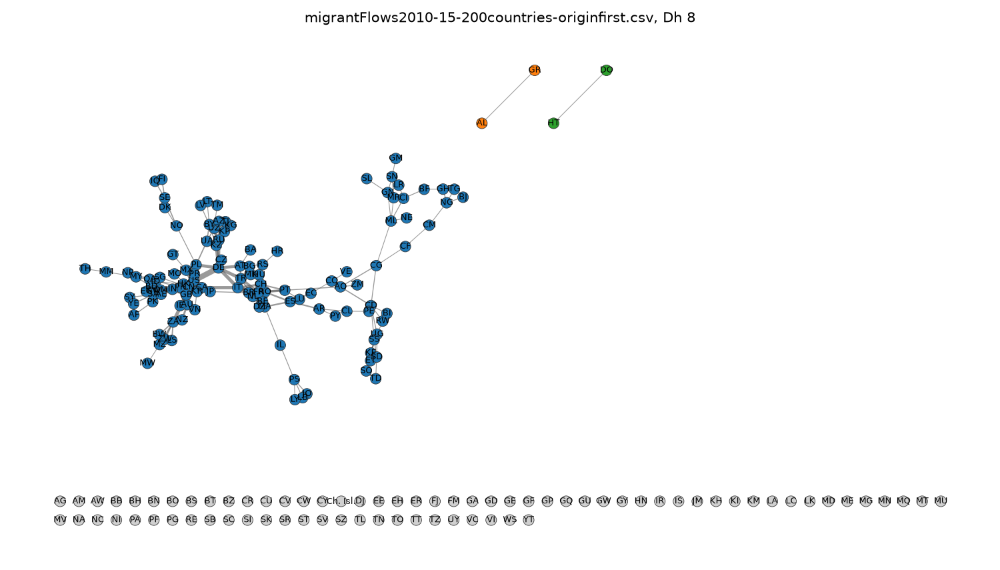
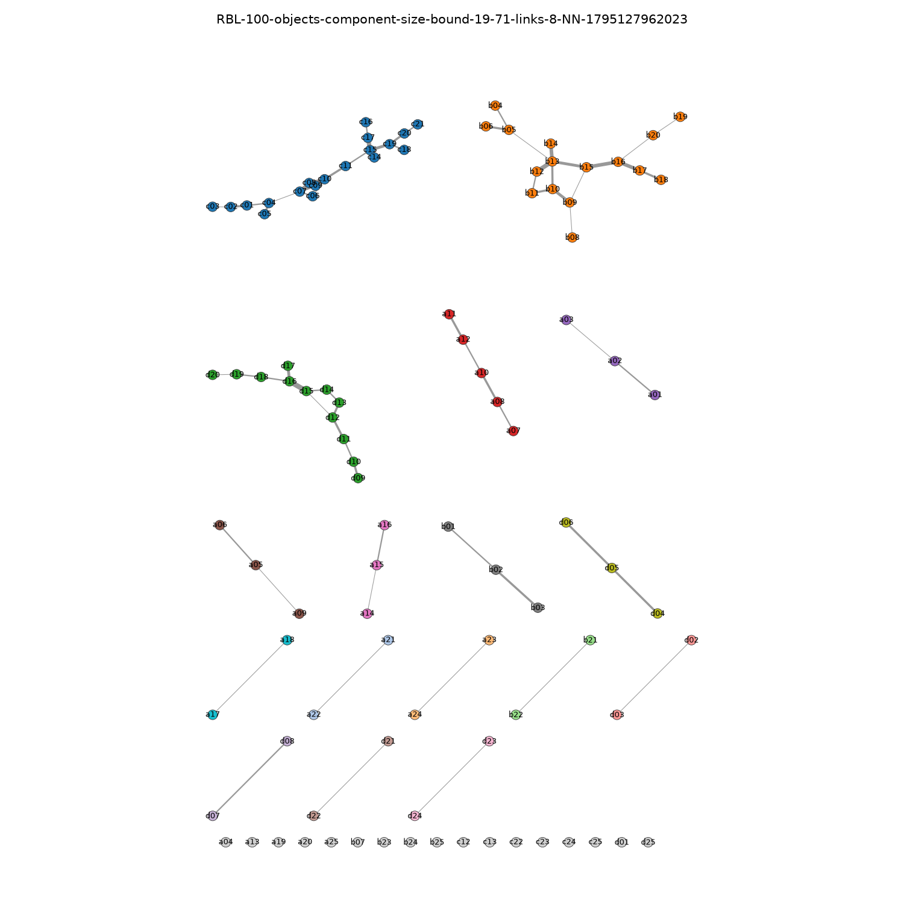

# rank-based-linkage

Rank-based linkage is a scalable algorithm for graph summarization and clustering. 
Input is an edge-weighted (di)graph. 
Instructions to execute on the java command line are found in the javadoc for the ClusteringByInsway class.
Mathematical foundations are explained in the paper:
<i>Rank-based linkage I: triplet comparisons and oriented simplicial complexes</i>, 
Darling, Grilliette and Logan, https://arxiv.org/abs/2302.02200

## Usage

Format of the CSV input file: each line is: source, target, weight.

Lines refer to edges of a graph, which may be directed or undirected.

Examples: 

"java -jar rbl.jar edgefileD.csv Dh 8 50"; graph is directed, higher weight means more similar

"java -jar rbl.jar edgefileD.csv Dl 8 50"; graph is directed, lower weight means more similar

"java -jar rbl.jar edgefileU.csv Uh 16"; graph is undirected, higher weight means more similar

"java -jar rbl.jar edgefileU.csv Ul 16"; graph is undirected, lower weight means more similar.

First integer (e.g. 8) is number of near neighbors to be ranked.

Optional second integer (e.g. 50) is maximum cluster size to be used in setting in-sway threshold.

Full details: see Javadoc for the ClusteringByInsway class.

 The output is a CSV file containing the linkage graph, or a prominent part of it. Each row is a pair of objects ("mutual friends" in the language of the paper) and an integer representing the in-sway of these two objects. There is also an HTML log file describing what happened in the rbl computation.

 In the resources folder are two .csv files containing directed weighted graph data used in our paper. Here "Dh" is the appropriate setting.

## Displaying the linkage graph

 The Python script tools/visualize/rbl_visualize.py (needs networkx and matplotlib) reads the output folder written by rbl.jar and draws a force-directed embedding of the linkage subgraph. Objects are coloured by component, edge width grows with in-sway, and isolated objects are shown in grey below the components. Output may be .png, .svg, .pdf, or .html (a self-contained page; hover over an object or link to see its component or in-sway).

"java -jar rbl.jar migrantFlows2010-15-200countries-originfirst.csv Dh 8"

"python tools/visualize/rbl_visualize.py RBL-199-objects-component-size-bound-121-189-links-8-NN-(timestamp) -o graph.png -o graph.html"

 Option --seed fixes the layout (default 1). Option --no-singletons omits isolated objects. Tests: "cd tools/visualize; python -m pytest".

## Network traffic preprocessor

 The class preprocessing.TrafficLineGraphBuilder implements item (1) of the future plans below. Input is a CSV file whose lines are: record ID, source address, destination address, numerical time stamp (a header line is allowed). Records e and f are linked if the destination of e is the source of f and e precedes f in time; the weight is the time difference. An optional third argument is the maximum time difference between linked records.

"java -cp rbl.jar preprocessing.TrafficLineGraphBuilder traffic.csv lineGraph.csv 60"

"java -jar rbl.jar lineGraph.csv Ul 8"

 The test resources folder contains syntheticTraffic.csv: four relay sessions among disjoint groups of four hosts (record IDs a.., b.., c.., d..) plus ten random cross-group records (x..). With maximum time difference 60 the line graph has 211 edges, and every link in the linkage subgraph from "Ul 8" joins two records of the same session. The class preprocessingTests.TestTrafficLineGraphBuilder checks the line graph of six records by hand.

## Sample output

 The image above comes from the migrant flow data. The commands below run the whole traffic pipeline on src/test/resources/syntheticTraffic.csv (100 records, four sessions a.., b.., c.., d.. plus cross-group noise x..) and draw the result:

"java -cp rbl.jar preprocessing.TrafficLineGraphBuilder syntheticTraffic.csv lineGraph.csv 60"

"java -jar rbl.jar lineGraph.csv Ul 8"

"python tools/visualize/rbl_visualize.py RBL-100-objects-component-size-bound-19-71-links-8-NN-(timestamp) -o traffic-Ul-8.png"

 The line graph has 211 edges. The linkage subgraph has 100 objects, 71 links, 17 components (largest 19) and 17 isolated objects, with in-sway from 5 to 11. The first lines of the 71-modest-edges.csv file written by rbl.jar (component, source, target, in-sway):
<pre>
component,source-vertex,target-vertex,weight
0,a02,a03,5
2,a05,a09,5
3,a14,a15,5
4,a17,a18,5
5,a21,a22,5
</pre>

 Each coloured component lies within one session (here the c.. and b.. sessions come out as the two large components at the top); isolated objects are the grey dots at the bottom.

## Future plans

 (1) Create a Java preprocessor for network traffic data where each record includes a record ID, a source address, a destination address, and a time stamp. Build an undirected line graph, where records e and f are adjacent if the destination of e is the source of f, and e precedes f in time. Record e orders its neighbors by absolute difference between their time stamps and e's own time stamp. The preprocessor exports a CSV file whose lines are of the form: 
e (record ID), f (record ID), time difference between e and f. 
This file becomes an input for rbl.jar with Ul as input parameter.

 (2) Create a Java preprocessor for bipartite transactional data where each each record includes a consumer ID, a product ID, and a numerical quantity. Suppose the goal is unsupervised learning for products. Construct the transition matrix for the Markov chain whose state space is product IDs, and whose transition rate p(x, y) from product x to product y is computed as follows. Sample at random a consumer who bought product x, weighted by quantity. Then sample at random a product purchased by this consumer, again weighted by quantity, and denote this random product ID by Z. Take p(x,y) to be the probability of {Z=y}. The preprocessor exports a CSV file whose lines are of the form: x (product ID), y (product ID), p(x,y). This file becomes an input for rbl.jar with Dh as input parameter.

 (3) Create (in any language) a post-processor which displays a force-directed embedding of a linkage graph, read from the output of rbl.jar. Suitable display tools include NetworkX, iGraph, Mathematica, and NetworkIT.

